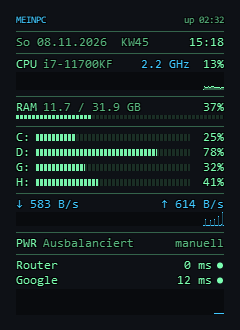
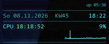
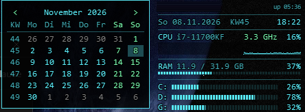

# Sysglow

Schlankes Desktop-Widget für Windows im Hacker-Stil – geschrieben in Rust, ohne Laufzeit, ohne Treiber.
Ersetzt Rainmeter-Skins für Systemwerte und Ping.



Maus auf einem Graphen zeigt Uhrzeit und Wert der Messung:



Klick auf das Datum öffnet den Kalender:



## Funktionen

- **Elemente**, jedes einzeln an/aus (Rechtsklick → *Elemente* oder `module =` in der ini):
  - `kopf` – Rechnername (kleine Schrift) und Laufzeit
  - `uhr` – Wochentag, Datum, Kalenderwoche, Uhrzeit
  - `cpu` – Last, aktueller Takt (GHz), Verlaufsgraph
  - `ram` – belegt/gesamt, Balken
  - `platten` – alle festen Laufwerke mit Füllstand
  - `netz` – Download/Upload mit Verlaufsgraph
  - `energie` – aktiver Energieplan und erkanntes Spiel; Klick wechselt den Plan, Doppelklick öffnet die Energieoptionen
  - `ping` – beliebig viele Hosts (ICMP), Farbe nach Schwellwert, optional Graph
- **Energieplan automatisch**: Startet ein Spiel (Prozess aus `spiele` oder Direct3D-Vollbild), schaltet glow auf `plan_spiel` (Höchstleistung); ist das Spiel beendet, zurück auf `plan_normal` (Ausbalanciert). Umgeschaltet wird nur beim Wechsel – wer zwischendurch von Hand umstellt, wird nicht überstimmt. Funktioniert auch, wenn das Element `energie` ausgeblendet ist; abschalten mit `energie_auto = 0` oder im Menü.
- **Farben**: Rechtsklick → *Farbe* (grün, cyan, blau, lila, amber, rot, weiß) oder eigene Farbe als `RRGGBB` in der ini
- Liegt nur auf dem Desktop (unter allen Fenstern), blendet sich bei Vollbild und Spielen aus
- Tray-Icon, verschiebbar per Maus, Position wird gespeichert
- Hover zeigt Details (freier Platz, IP-Adresse), Klick auf einen Ping schaltet dessen Graph
- Hover auf einen Graphen (CPU, Netz, Ping) zeigt Uhrzeit und Wert dieser Messung
- Klick auf Datum oder Uhrzeit öffnet den Kalender links neben dem Widget: `<` `>`, Mausrad oder Pfeiltasten wechseln den Monat, Klick auf den Titel springt zu heute, Esc oder Klick daneben schließt
- Doppelklick: CPU/RAM/Netz → Task-Manager, Laufwerk → Explorer, Ping → eigener Befehl
- ini wird beim Speichern automatisch neu geladen
- Sehr sparsam: ca. 770 KB exe, ca. 18 MB RAM, kaum CPU
- Nur normale Windows-Abfragen (kein Treiber, keine Injektion) – unauffällig für Anti-Cheat

## Installation

1. `Sysglow.exe` von der [Release-Seite](https://github.com/IcHiAT/sysglow/releases/latest) laden und in einen eigenen Ordner legen, z. B. `%LOCALAPPDATA%\Programs\Sysglow\`.
2. Starten – beim ersten Start entsteht `sysglow.ini` daneben. Die exe ist nicht signiert, deshalb kann Windows SmartScreen beim ersten Start warnen („Weitere Informationen“ → „Trotzdem ausführen“).
3. Rechtsklick → *Mit Windows starten* für Autostart, *Im Startmenü anzeigen* für den Eintrag im Startmenü.

Läuft unter Windows 10/11. Die Benutzung erfolgt auf eigene Gefahr.

### Installieren ohne Administratorrechte

In einer normalen PowerShell im Ordner des Repos starten:

```powershell
.\werkzeug\installieren.ps1
```

Das Skript holt die neueste `Sysglow.exe`, prüft ihre Prüfsumme, legt sie nach `%LOCALAPPDATA%\Programs\Sysglow\`, richtet einen Startmenü-Eintrag ein und startet Sysglow. Es erscheint keine Windows-Abfrage. Ein erneuter Aufruf aktualisiert, `-Entfernen` deinstalliert, dazu zählen auch Autostart und Startmenü-Eintrag; die `sysglow.ini` bleibt erhalten. Mit `-AlleBenutzer` geht es stattdessen nach `C:\Program Files\Sysglow`, dafür fragt Windows einmal nach Administratorrechten, und die `sysglow.ini` steht dann in `%APPDATA%\Sysglow\`.

## Konfiguration (`sysglow.ini`)

| Schlüssel | Bedeutung | Standard |
|---|---|---|
| `module` | Elemente in Reihenfolge: `kopf uhr cpu ram platten netz energie ping` | alle |
| `breite` | Breite in Pixeln (100 % Skalierung) | 220 |
| `aktualisierung` | Sekunden zwischen Messungen von CPU, RAM, Platten, Netz | 1 |
| `intervall` | Sekunden zwischen zwei Pings (Werte und Ping-Graph) | 5 |
| `timeout` | ms bis „TIMED OUT“ | 3000 |
| `graph_max` | Obergrenze des Ping-Graphen in ms | 500 |
| `gelb` / `rot` | Prozent-Schwellen für CPU, RAM, Platten | 80 / 90 |
| `hintergrund` | Deckkraft des dunklen Hintergrunds 0–255 | 0 |
| `rand_rechts` / `rand_oben` | Abstand zum Rand, solange nicht verschoben | 0 |
| `pos_x` / `pos_y` | gespeicherte Position | – |
| `gesperrt` | 1 = nicht verschiebbar | 0 |
| `farbe` | Schema (`gruen cyan blau lila amber rot weiss`) oder `RRGGBB` | gruen |
| `akzent` | zweite Farbe `RRGGBB` (Netz, Takt, Graphen), leer = zum Schema passend | – |
| `energie_auto` | 1 = Energieplan bei Spielstart/-ende umschalten | 1 |
| `plan_spiel` / `plan_normal` | GUIDs aus `powercfg /list` | Höchstleistung / Ausbalanciert |
| `spiele` | Prozessnamen ohne `.exe`, Leerzeichen getrennt | `r5apex r5apex_dx12` |

Ping-Hosts, eine Zeile pro Host:

```
# Name | Adresse | gelb ab ms | rot ab ms | Graph 0/1 | Doppelklick-Befehl (optional)
Router     | 192.168.1.1 | 40 | 80 | 0 | cmd.exe
Google     | 8.8.8.8     | 40 | 80 | 1
```

## Bauen

Benötigt Rust (stable, Ziel `x86_64-pc-windows-gnu` oder `-msvc`):

```
cargo build --release
```

Ergebnis: `target\release\sysglow.exe`.

## Aufbau des Codes

| Datei | Inhalt |
|---|---|
| `src/main.rs` | Fenster, Maus, Menü, Tray, Autostart |
| `src/app.rs` | Zustand und je eine Funktion pro Element (`el_kopf`, `el_cpu`, …) |
| `src/config.rs` | ini lesen, Standardwerte, Elemente an/aus |
| `src/stats.rs` | Systemwerte (CPU, Takt, RAM, Platten, Netz) |
| `src/ping.rs` | ICMP-Ping im Hintergrund-Thread pro Host |
| `src/power.rs` | Energieplan lesen/setzen, laufende Spiele erkennen |
| `src/kalender.rs` | Kalender-Popup |
| `src/gfx.rs` | Zeichnen (Text mit Kontur, Balken, Graphen), Tray-Icon |

Ein neues Element: Namen in `KNOWN_MODULES` (`config.rs`) eintragen, `el_<name>` in `app.rs` schreiben und in `render()` zuordnen, Menütext in `show_menu()` (`main.rs`) ergänzen.

## Name und Icon in der exe

Der Task-Manager zeigt Dateibeschreibung, Herausgeber (`-Firma`, Standard IcHiAT) und Icon der exe, im Autostart-Tab erst nach einigen Sekunden. Der GNU-Toolchain bindet keine Ressourcen ein, deshalb nach jedem Build:

```powershell
.\werkzeug\ressourcen.ps1 -Exe <pfad>\sysglow.exe -Ico .\assets\sysglow.ico -Name Sysglow -Version 0.4.0
```
